# 🐳 Docker Course Summary

My notes and hands-on summary from the Docker course: from "what is a container?" all the way to multi-container apps with Docker Compose, networking, and persistent storage.

The practical project used throughout the course is a **Flask API container talking to a MySQL container**.

> The full hand-drawn board (Excalidraw export) is in [`assets/main_board.svg`](assets/main_board.svg). Every diagram below was cut from it.

---

## 📑 Table of Contents

1. [Big Picture](#-big-picture)
2. [What is Docker?](#1-what-is-docker)
3. [Docker vs Virtual Machines](#2-docker-vs-virtual-machines)
4. [Docker on Windows (WSL)](#3-docker-on-windows-wsl)
5. [Images](#4-images)
6. [Dockerfile](#5-dockerfile)
7. [Container Lifecycle & Layers](#6-container-lifecycle--layers)
8. [CLI Cheat Sheet](#7-cli-cheat-sheet)
9. [Ports & Port Mapping](#8-ports--port-mapping)
10. [Docker Networks](#9-docker-networks)
11. [Docker Compose](#10-docker-compose)
12. [Docker Storage (Bind Mounts & Volumes)](#11-docker-storage)
13. [Quick Reference](#-quick-reference)

---

## 🗺️ Big Picture

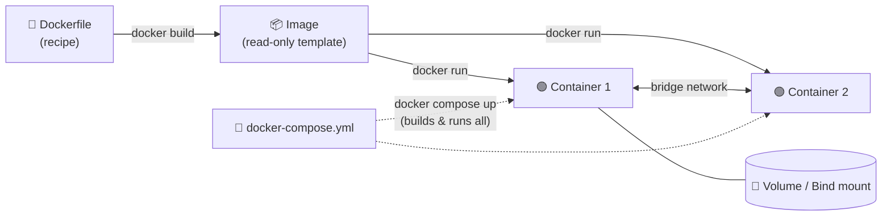

**One-line summary:** a *Dockerfile* builds an *image*, an image runs as a *container*, containers talk over *networks*, keep data in *volumes*, and *Compose* manages the whole stack from a single file.

---

## 1. What is Docker?

- A platform that lets you **package and run an application with all its dependencies** in an isolated unit called a **container**.
- Containers **share the host OS kernel** (unlike VMs, which each need their own OS).
- Uses **fewer resources** than a VM.

### What is a container?

- A package that contains **all the project's dependencies** (code, Python version, libraries, OS settings, applications).
- Can be **shared** easily.
- Solves the classic *"but it works on my machine"* problem, because the dependencies travel with the project instead of being missing on other machines.
- Every container has **its own file system**.

<p align="center">
  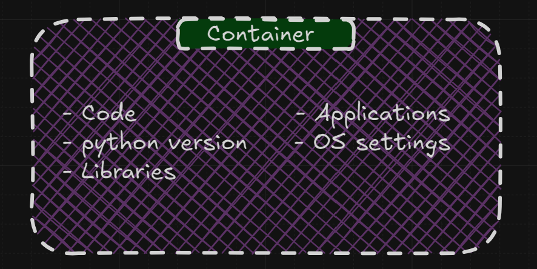
</p>

---

## 2. Docker vs Virtual Machines

**Why not just use a VM?** Because Docker is:

- ⚡ Fast to start
- 🧠 Sharing the same OS kernel
- 🪶 Lighter if you only want to run one or a few apps

> 💡 Use a VM only if you need a **completely different OS**.

<p align="center">
  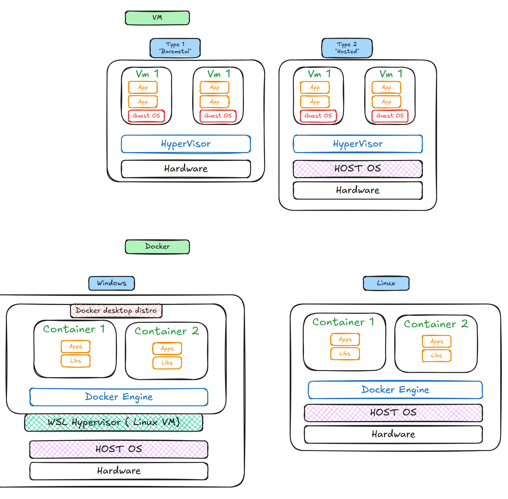
</p>

| | Docker (Container) | VM |
|---|---|---|
| **OS** | Shares host OS kernel | Own full OS each |
| **Size** | MBs (small) | GBs (big) |
| **Boot time** | Seconds | Minutes |
| **Speed** | Near-native (fast) | Slower |
| **Isolation** | Good | Strong |
| **Resource use** | Light | Heavy |
| **Best for** | Running apps | Running whole OSes |
| **Example** | Docker, Podman | VirtualBox, VMware, ESXi |

**VM types in the diagram**

- **Type 1 ("Bare metal")**: the hypervisor runs directly on the hardware.
- **Type 2 ("Hosted")**: the hypervisor runs on top of a host OS.

---

## 3. Docker on Windows (WSL)

- Docker containers need a **Linux kernel**, so on Windows, Docker Desktop runs its engine inside a **Linux VM provided by WSL** (the "Docker desktop distro" in the diagram above).
- WSL boots **much faster** than a normal VM and uses **less disk and RAM**.
- All Docker containers on Windows **share that one Linux VM**.

| | Docker (on Windows) | Normal VM |
|---|---|---|
| **How many VMs?** | 1 shared Linux VM (WSL 2) | 1 VM per OS you want |
| **Each app gets…** | Its own container (light) | Its own full OS (heavy) |
| **Size per app** | MBs | GBs |
| **Boot time** | Seconds | Minutes |
| **RAM use** | Shares 1 VM | Each VM takes its own RAM |

---

## 4. Images

- A container can't exist without a **package to run**: that package is the **image**.
- An image is a **template**; a **container is just a running instance of an image**.
- One image can run inside many containers.

<p align="center">
  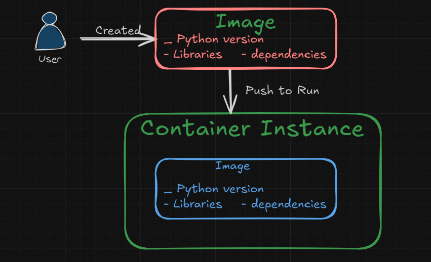
</p>

### Image types

<p align="center">
  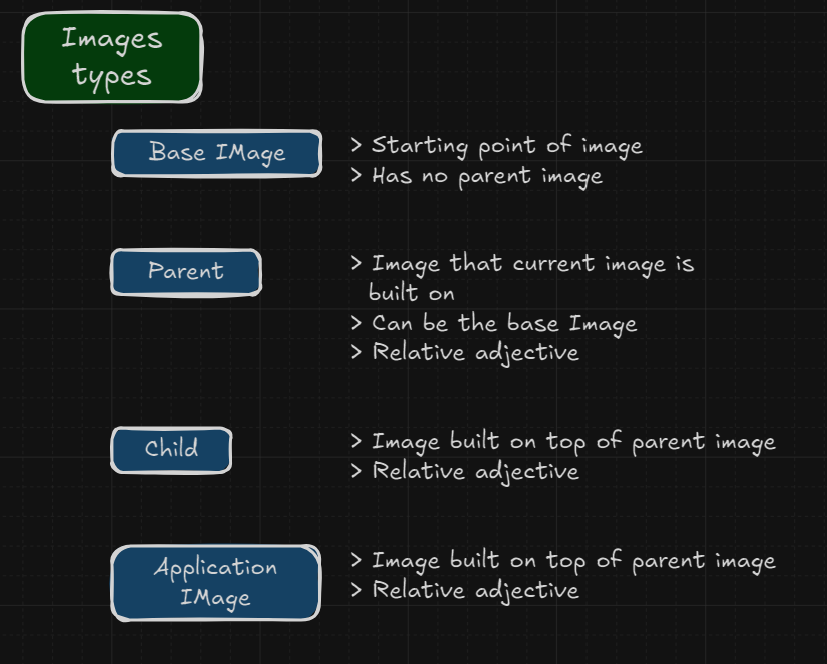
</p>

| Type | Meaning |
|---|---|
| **Base image** | The starting point of an image. Has **no parent image**. |
| **Parent image** | The image the current image is **built on**. Can itself be a base image. *(relative term)* |
| **Child image** | An image built **on top of a parent image**. *(relative term)* |
| **Application image** | An image built on top of a parent image that contains **your app**. |

---

## 5. Dockerfile

- A **plain text file** (no extension, named `Dockerfile`) used to **build an image**.
- **Each line creates a new layer**: a step that changes the image.
- Ready-made Dockerfiles / images can be downloaded from the internet.

### The simple rule

| Instruction | Meaning |
|---|---|
| `FROM` | start (base image) |
| `WORKDIR` | where to work |
| `COPY` | bring files in |
| `RUN` | install stuff (build time) |
| `CMD` | what to run (container start) |

### Annotated example

```dockerfile
# 1. Start from a base image
FROM python:3.12-slim

# 2. Set working directory inside the container
WORKDIR /app

# 3. Copy dependency list first (so Docker can cache this layer)
COPY requirements.txt ./

# 4. Install dependencies
RUN pip install -r requirements.txt

# 5. Copy all files from the current directory into the image's /app folder
#    (`COPY . .` = copy everything in the build context to WORKDIR)
COPY . .

# 6. Document the port the app listens on
#    (documentation only, it does NOT publish or map anything)
EXPOSE 5000

# 7. Command to run when the container starts
#    Each word of the command is an item in a list
CMD ["python", "code.py"]
```

**Notes**

- `WORKDIR` decides which folder in the container your commands run in. Each container has its own filesystem view, so each container has its own `/app`.
- `CMD` only runs **when the container is started**; you write the shell command you want, split into a list.
- `EXPOSE` is **documentation only**.

### Build → Run workflow

1. Write the `Dockerfile` (no file extension).
2. Save it in the project directory.
3. **Build** the image:
   ```bash
   docker build -t my-app .
   ```
   The `.` at the end is the **build context**: the folder whose files are available to `COPY` and `ADD`.
4. **Run** it (image → container):
   ```bash
   docker run --name container_name image_name
   ```

### Tagging an image

```bash
docker build -t my-app:tag .
```

### Running a command inside a running container

```bash
docker exec -it <container_id> python3 code.py
```

---

## 6. Container Lifecycle & Layers

### Lifetime

A container is alive **only as long as its `CMD` process is still running**. When the command finishes, the container stops.

### Read / write restrictions

| | Image | Container |
|---|---|---|
| **Access** | Read-only | Has a **writable layer** on top |
| **Layers** | Immutable: once built, they can't be changed | You can add to the writable layer (e.g. install a Python lib) |
| **Sharing** | Can be used by many containers | The writable layer is **removed when the container is deleted** |

> You can save a container as a **new image** to keep its changes.

<p align="center">
  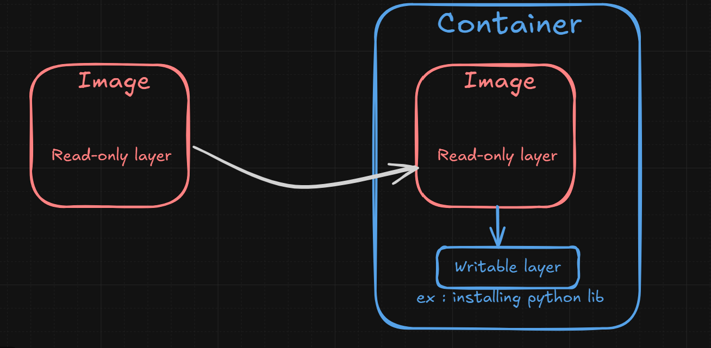
</p>

---

## 7. CLI Cheat Sheet

| Goal | Command |
|---|---|
| Build an image | `docker build -t my-app .` |
| Build with a tag | `docker build -t my-app:tag .` |
| Run a container | `docker run --name container_name image_name` |
| Run detached + port + name | `docker run -d -p <host_port>:<container_port> --name <container_name> <image_name>` |
| Start an existing container | `docker start container_name` |
| Stop a running container | `docker stop container_name` |
| Delete an image | `docker rmi image_name` |
| Run a command inside a container | `docker exec -it <container_id> python3 code.py` |
| Create a network | `docker network create <network_name>` |
| Run a container on a network | `docker run -d --name my-container --network my-net my-image` |
| Start all services (Compose) | `docker compose up` |
| Remove Compose containers | `docker compose down` |

---

## 8. Ports & Port Mapping

### What is a port?

- A **data gate** that belongs to an IP address.
- One IP address has **many ports**.
- Each process on a machine sends/receives network data through **a different port** (e.g. MySQL uses its own port).

### Port mapping

- A container's ports are **not reachable from outside the machine** by default.
- **Port mapping** connects a port on the **host machine** to a port in the **container**.

<p align="center">
  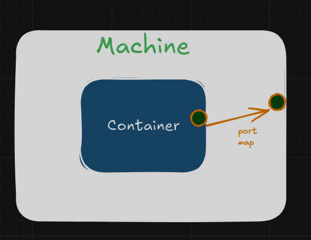
</p>

```bash
docker run -d -p <host_port>:<container_port> --name <container_name> <image_name>
```

> ⚠️ Port mapping is set **only when the container is created**.
> ⚠️ Two containers **cannot map to the same host port**.

---

## 9. Docker Networks

Networks let **isolated containers talk to each other** over an internal network.

| Type | Behavior |
|---|---|
| **Bridge** *(default)* | Containers on the same bridge can talk using IP. The bridge acts like a **router** that gives each container an internal IP. |
| **Host** | **Not isolated**: the container uses the host's IP and ports directly (no port mapping). |
| **None** | **No network at all**: fully isolated. |

### Bridge network

<p align="center">
  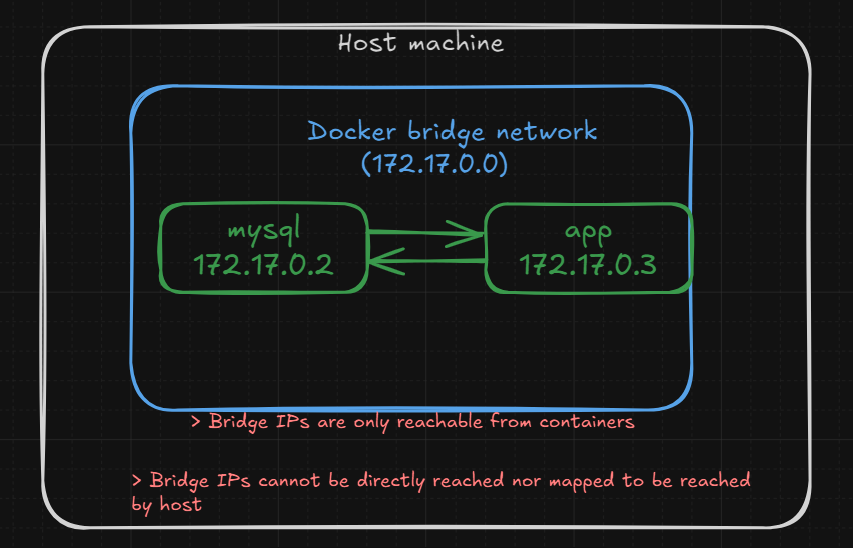
</p>

- No port mapping needed to reach a container's bridge IP **from the host**.
- Bridge IPs live in a **private IP range**, so they **can't be reached from the outside world**, only from the host.
- For one container to reach another, it calls the other's IP (e.g. `172.17.0.2`)...
- ...or, better, **uses the container name**, which is resolved by Docker's DNS (see below).

#### Bridge network: connectivity facts

| Source | Destination | Allowed |
|---|---|:---:|
| Container | Container (same bridge) | ✅ |
| Container | Container (different bridge) | ❌ |
| Container | Host | ✅ |
| Container | Internet | ✅ |
| Container | LAN machines | ✅ |
| Host | Container (bridge IP) | ✅ |
| Host | Container (`localhost:port`) | ❌ (needs `-p`) |
| LAN machine | Container (bridge IP) | ❌ |
| LAN machine | Container (`host-ip:port`) | ❌ (needs `-p`) |
| Internet | Container (bridge IP) | ❌ |
| Internet | Container (`host-ip:port`) | ❌ (needs `-p`) |

#### The rule: when do you need port mapping?

| Direction | Needs port mapping? |
|---|---|
| **Container → Container** (same network) | ❌ No: use service name or container IP |
| **Host → Container** | ✅ Yes: via `-p host:container` |
| **Container → Internet** | ❌ No: works by default (NAT) |
| **Container → Host** | ❌ No: via `host.docker.internal` |
| **Outside world → Container** | ✅ Yes: publish a port |

> The bridge network lets **containers talk to each other**. It does **not** expose them to the host.

### Create & use a custom network

```bash
# create a bridge network (bridge is the default driver)
docker network create <network_name>

# add a container to the network while starting it
docker run -d --name my-container --network my-net my-image
```

### Docker local DNS (container names as hostnames)

On a **user-defined** bridge network, Docker provides a built-in DNS that translates **container names → IPs**.

<p align="center">
  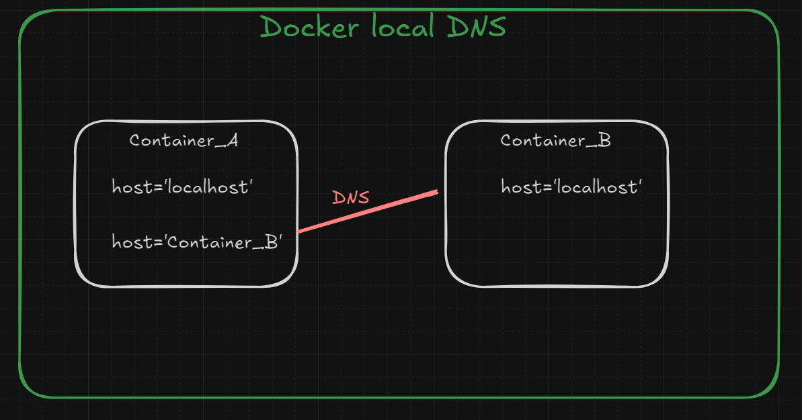
</p>

- Inside the **Flask** container, the MySQL host is the **MySQL container's name**, **not** `localhost` (`localhost` would point to the Flask container itself).
- You *could* use the bridge IP instead of the name, but it's **not recommended**: the IP can change when the container restarts.

```python
# ❌ wrong: localhost is the Flask container itself
host = "localhost"

# ✅ right: the MySQL container's name, resolved by Docker DNS
host = "mysql_container"
```

### `docker-entrypoint-initdb.d`

- A special directory in official database images (like MySQL).
- Put `.sql` files in it, and they are **run automatically the first time the container is initialized**.

---

## 10. Docker Compose

Instead of running each container by hand, **describe everything in a single `.yml` file**:

- Run and stop containers in your wanted order from one file.
- `compose up` can use existing images **and build new ones**.

<p align="center">
  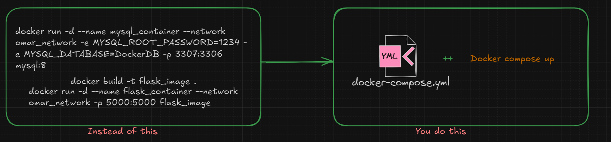
</p>

**Instead of this:**

```bash
docker run -d --name mysql_container --network omar_network \
  -e MYSQL_ROOT_PASSWORD=1234 -e MYSQL_DATABASE=DockerDB \
  -p 3307:3306 mysql:8

docker build -t flask_image .
docker run -d --name flask_container --network omar_network \
  -p 5000:5000 flask_image
```

**You do this:** `docker compose up`

### YAML file structure

```yaml
name: flask_mysql_network

services:
  mysql_container:
    image: mysql_image            # name of your existing MySQL image
                                  # (use `build:` instead to build from a Dockerfile)
    ports:
      - "3307:3306"
    networks:
      - omar_network

  flask_container:
    image: flask_image
    ports:
      - "5000:5000"
    depends_on:
      - mysql_container           # start MySQL first
    networks:
      - omar_network

networks:
  omar_network:
    external: true                # network already exists (docker network create omar_network)
```

### Good to know

- `docker compose down` **deletes** the containers.
- `docker compose up` **creates** them again.
- Compose names containers as **`<project>-<service>-<index>`**.

---

## 11. Docker Storage

**The problem.** When an image is built, your code and `requirements.txt` get copied into it. But:

- What if your data is **too big to copy into an image**? ➜ **Bind mounting**
- What if you want to keep **logs or data generated inside a container**, which would be lost on `compose down`? ➜ **Named volumes**

### Bind mounting

Attach a **directory (or file) from your machine** to a container so the container can use it.

<p align="center">
  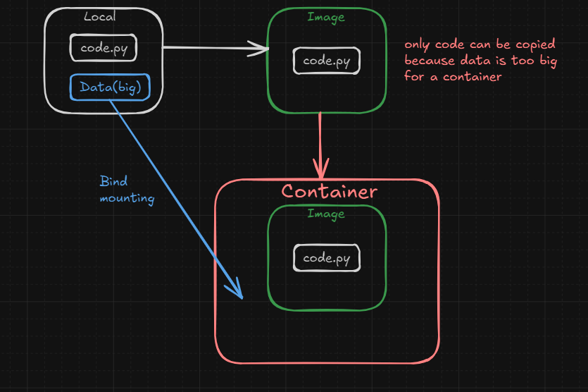
</p>

Only the code is copied into the image; the big data is **bind mounted** into the running container.

```yaml
volumes:
  - HOST_PATH:CONTAINER_PATH
```

### Named volumes

A **Docker-managed directory** attached to a container. It lives on the host but **you don't manage it manually**, and it **survives** container deletion.

**Example:** MySQL stores its data in `/var/lib/mysql` inside the container. That folder is deleted whenever the container is removed (e.g. `compose down`), so we mount a volume there.

<p align="center">
  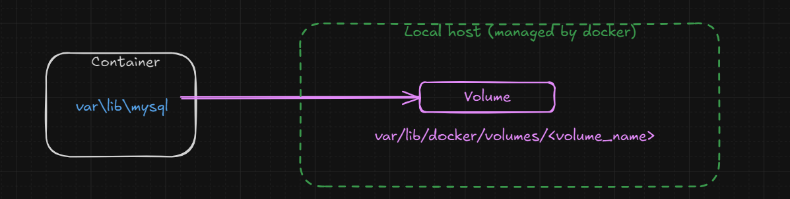
</p>

Docker stores the volume on the host at `/var/lib/docker/volumes/<volume_name>`.

```yaml
# using the YAML file
volumes:
  - <volume_name>:/var/lib/mysql
```

```bash
# using the CLI: creating & using a volume
docker run -d -v mysql_data:/var/lib/mysql mysql:8.0

# using an existing volume / general form
docker run -v SOURCE:TARGET[:OPTIONS] IMAGE
```

### Syntax difference in YAML: how Docker decides

> **Bind mount** = *"mount this **host path** into the container."*
> **Named volume** = *"mount this **Docker-managed storage** into the container."*

| Written as | Left side | Type |
|---|---|---|
| `mysql_data:/var/lib/mysql` | `mysql_data` (no slash) | **Named volume** ✅ |
| `./config.cfg:/app/config.cfg` | `./config.cfg` (starts with `.`) | **Bind mount** ✅ |
| `/home/omar/logs:/app/logs` | `/home/omar/logs` (starts with `/`) | **Bind mount** ✅ |
| `~/config:/app/config` | `~/config` (starts with `~`) | **Bind mount** ✅ |

---

## ⚡ Quick Reference

| Concept | One-liner |
|---|---|
| **Image** | Read-only template (built from a Dockerfile) |
| **Container** | A running instance of an image, with a writable layer on top |
| **Layer** | One Dockerfile step; images are stacks of immutable layers |
| **Port mapping** | `-p host:container`, set at container creation |
| **Bridge network** | Default network; containers talk by IP, or by **name** on user-defined bridges |
| **Compose** | One YAML file to build/run/stop a whole multi-container app |
| **Bind mount** | Host path → container |
| **Named volume** | Docker-managed storage → container (persists after `down`) |

---

## 🗂️ Repository Structure

```
.
├── README.md
└── assets/
    ├── main_board.svg            # full Excalidraw board
    ├── board-preview.png         # preview of the whole board
    ├── container.png
    ├── docker-vs-vm.png
    ├── image-to-container.png
    ├── image-types.png
    ├── image-layers.png
    ├── port-mapping.png
    ├── bridge-network.png
    ├── docker-dns.png
    ├── compose-before-after.png
    ├── bind-mount.png
    └── named-volume.png
```
